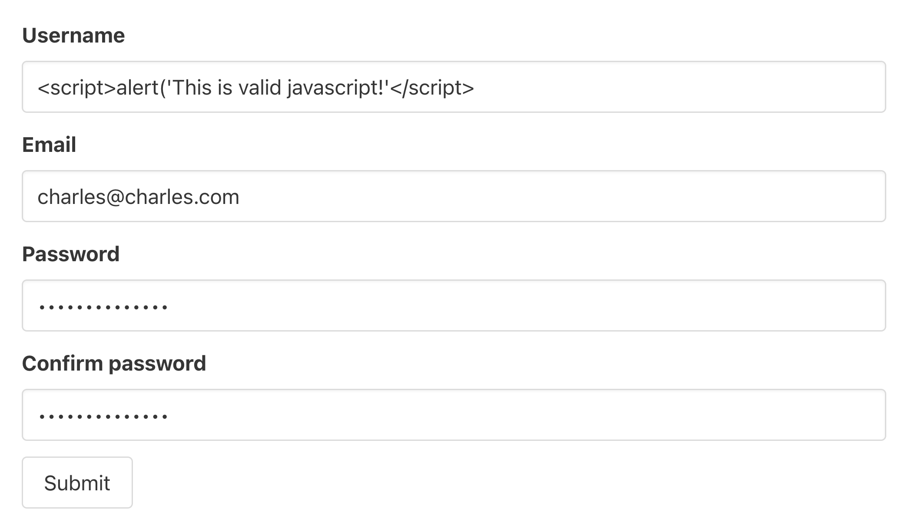

<h1>
  <span class="headline">FastAPI Security SQL Injection</span>
  <span class="subhead">Concepts</span>
</h1>

**Learning objective:** By the end of this lesson, students will be able to understand the importance of application security, identify and explain common security vulnerabilities including SQL Injection.

## Security in application development

Security is an essential component of application development. We've already touched on several concepts to make applications secure, such as:

- **Authentication**: Ensuring someone is who they say they are.
- **Authorization**: Ensuring someone has the right to take a specific action.
- **Minimizing attack surfaces**: Reducing vulnerabilities by limiting the fields exposed through API endpoints.
- **Protecting sensitive data**: Hashing passwords instead of storing plaintext.

In this lesson, we will focus on **SQL Injection**, a critical security vulnerability that poses significant risks to applications utilizing relational databases.

## Intro to common vulnerabilities

### 1. Cross-Site Scripting (XSS)

**What it is**: An attack where a malicious script is injected into a website and executed in a user's browser.

**Example**: A user enters JavaScript code as their username, which is then executed in another user's browser, potentially stealing information or compromising the client.



**How to reduce the risk:**

- Escape user inputs by removing dangerous tags (ex: `<script>`).
- Use frameworks that sanitize inputs by default.

### 2. Cross-Site Request Forgery (CSRF)

**What it is**: An attacker tricks a user into making unintended requests to a server where they are already authenticated.

**Example**: A malicious website mimics your bank’s login form. When you submit the form, your browser sends valid cookies, leading to unauthorized actions on your account.

**How to reduce the risk:**

- Use **CSRF tokens** or **JWT tokens** stored outside cookies.
- Reject requests without the proper token.

### 3. Man-In-The-Middle (MitM) attacks

**What it is**: A malicious actor intercepts communication between a client and a server to steal or manipulate data.

**How to reduce the risk:**

- Always use **TLS/HTTPS**.
- Obtain and maintain TLS certificates from services like **Let’s Encrypt**.

### 4. SQL Injection

SQL Injection is one of the most common and dangerous application-level attacks. Like XSS, it involves injecting malicious input, but here the target is a database.

**What it is**:

- SQL Injection is a type of attack where an attacker provides malicious SQL code as input to exploit vulnerabilities in how your application queries a database. This allows the attacker to manipulate the query, potentially gaining unauthorized access to data, bypassing authentication, or even altering or deleting database records.

**Why it's dangerous**:

- It can expose sensitive data.
- It may allow attackers to alter or delete data in your database.

#### Example

Let’s say your application has a login form that takes a user’s `id` as input and runs the following SQL query to fetch their details:

```sql
SELECT * FROM users WHERE id = 1;
```

This query is designed to return information about the user with an `id` of `1`.

However, if the application doesn't validate or sanitize user input, an attacker could submit malicious input like `1 OR 1=1`. This modifies the query to:

```sql
SELECT * FROM users WHERE id = 1 OR 1=1;
```

**Why `1=1` is significant**

- The condition `1=1` always evaluates to `true`, so the query now ignores the `id` filter.
- As a result, the database interprets the query as: "Return all rows in the `users` table."
- This could expose **all user data**, including sensitive information like passwords or email addresses.

## SQL Injection: How to mitigate the risk

1. **Sanitize inputs**

   - Strip out special characters like quotes, semicolons, or SQL keywords from user input.

2. **Parameterized queries**
   - Use parameterized statements in SQL queries to prevent direct execution of user input.
   - Example with Python and SQLAlchemy:

```python
 query = text("SELECT * FROM users WHERE id = :id")
 result = session.execute(query, {"id": user_input})
```

3. **Use an ORM**

   - Frameworks like SQLAlchemy help mitigate SQL Injection risks by abstracting away raw SQL queries.
   - However, be cautious and review which methods are safe.

4. **Be wary of raw SQL**
   - Only use raw SQL when absolutely necessary, and always parameterize user inputs.

## Whats next:

Now that you’re familiar with common vulnerabilities, we’ll dive deeper into **SQL Injection** in the upcoming lessons. You’ll learn:

- How to identify SQL Injection vulnerabilities in an application.
- Best practices to secure your API endpoints and database queries.
- Hands-on approaches to implementing protections using Python and FastAPI.

<br>

**OWASP Top 10**

If you are interested in learning more about common vulnerabilities on the web, we encourage you to explore the **[OWASP Top 10](https://owasp.org/www-project-top-ten/)**

*The OWASP Top 10 is a standard awareness document for developers and web application security. It represents a broad consensus about the most critical security risks to web applications.*